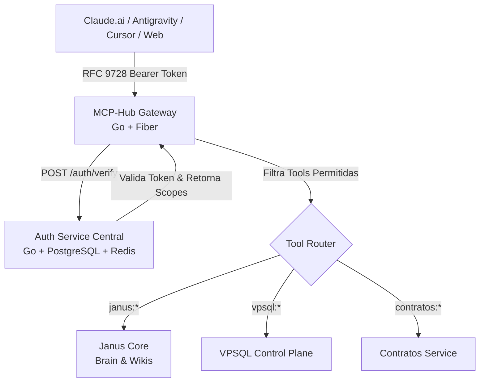

# Especificação Técnica: Auth Service & MCP-Hub em Golang

> **Status:** Planejamento / Especificação Técnica  
> **Objetivo:** Centralizar a gestão de acessos, autenticação multi-tenant de clientes e a exposição unificada de ferramentas MCP com suporte ao RFC 9728.

---

## 1. Visão Arquitetural

---

## 2. Auth Service (Microsserviço de Identidade)

### 2.1. Requisitos Técnicos
- **Linguagem:** Go 1.23+ com framework Fiber.
- **Banco de Dados:** PostgreSQL (armazenamento de tenants, clients, roles, permissions) + Redis (cache rápido e revogação).
- **Latência Alvo:** < 1 ms por verificação no endpoint `POST /auth/verify`.
- **Pegada de Memória:** ~20 MB de RAM.

### 2.2. Modelos de Credenciais Suportados
1. **API Keys M2M (`eo_live_...`)**:
   - Chaves criptográficas com prefixo visível e hash SHA-256 no banco.
   - Ideal para servidores, crons e automações locais.
2. **JWT EdDSA (Ed25519)**:
   - Tokens assinados digitalmente com par de chaves assimétricas.
   - Endpoint público de chaves `GET /.well-known/jwks.json`.
   - Permite que qualquer microsserviço valide a assinatura e os claims localmente em microssegundos sem roundtrip HTTP.

### 2.3. Multi-Tenant Nativo
- Isolamento por `tenant_id` (ex: `cliente_alpha`, `gestao_pessoas`, `admin`).
- Permissões no formato namespace: `janus:read`, `janus:write`, `vpsql:query`, `contratos:create`.

---

## 3. MCP-Hub (Gateway Unificado de Ferramentas)

### 3.1. Funcionalidades
1. **Ponto de Entrada Único (`ALL /mcp`)**:
   - Agrega ferramentas de todos os microsserviços do ecossistema Elias em um único endpoint.
2. **Filtragem Dinâmica de Tools (Tool Gating)**:
   - Ao receber `tools/list`, inspeciona o token do cliente e retorna apenas as ferramentas que ele tem permissão de usar.
3. **Conexão Nativa com Claude.ai (RFC 9728)**:
   - Implementa endpoints de descoberta:
     - `GET /.well-known/oauth-protected-resource`
     - `GET /.well-known/oauth-protected-resource/mcp`
   - Permite autenticação individual via Custom Connectors no Claude.ai e Antigravity.
